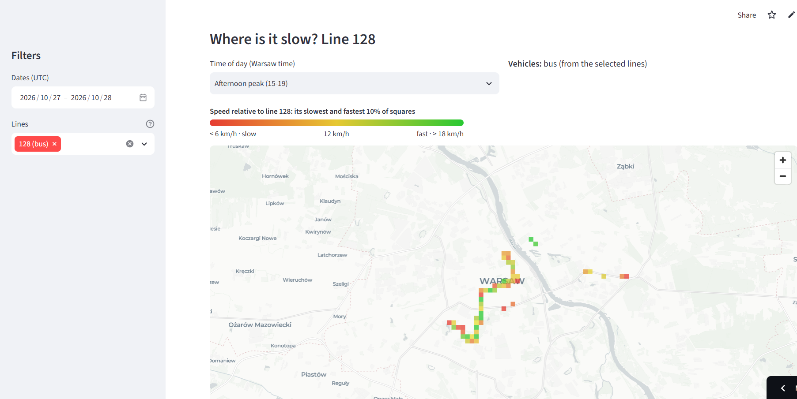
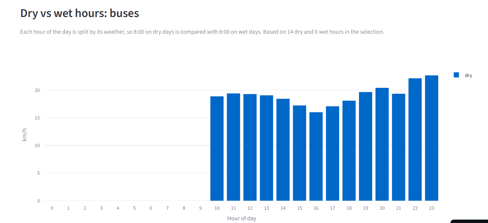
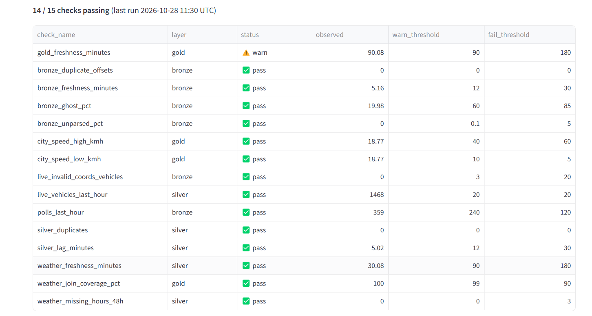

# Warsaw Transit Pulse

Warsaw publishes live positions for its buses and trams, updated about every 10 seconds. I built a streaming pipeline around this feed to see how vehicle speeds change by line, time of day and location.

**Live dashboard:** https://warsaw-transit-pulse.streamlit.app
(free hosting: if the app is asleep, click the wake up button and wait about 30 seconds)



I wanted something closer to a production pipeline than a project on a static dataset. The live feed meant dealing with duplicates, stale positions, API failures and recovering after restarts. The pipeline runs on its own, checks its own data every 30 minutes and sends me a phone alert when a check fails.

---

## Architecture

```
  City of Warsaw API
          │  every 10 s, buses and trams
          ▼
  ┌──────────────┐  Python, Docker. Retries with backoff, circuit breaker
  │    poller    │  after 3 failed polls, one Kafka message per vehicle
  └──────┬───────┘
         ▼
  ┌──────────────┐  KRaft mode, 3 partitions, 14 days retention
  │    Kafka     │  (enough to replay any layer from scratch)
  └──────┬───────┘
         ▼
  ┌──────────────┐  Spark Structured Streaming → Delta Lake
  │    bronze    │  raw message + Kafka partition/offset
  └──────┬───────┘
         ▼
  ┌──────────────┐  Spark Structured Streaming → Delta Lake
  │    silver    │  UTC timestamps, live vehicles only, service area
  └──────┬───────┘  filter, deduplication with a watermark
         ▼
  ┌──────────────┐  Airflow, hourly Spark batch jobs
  │     gold     │  speed per line/hour, speed map grid,
  └──────┬───────┘  hourly weather from Open-Meteo
         │
         ├────────► data quality checks every 30 min → ntfy alert
         ▼
  ┌──────────────┐  nightly: DuckDB exports ~3 MB of Parquet
  │   publish    │  to a public data repo
  └──────┬───────┘
         ▼
     Streamlit dashboard (DuckDB inside the app)
```

**Stack:** Python, Kafka 4.1, Spark 4.0 (Structured Streaming and batch), Delta Lake 4.0, Airflow 3, DuckDB, Streamlit, Docker Compose.

---

## Implementation details

**Ingestion.** The poller calls the API for buses and trams every 10 seconds and sends one message per vehicle, with the receive time and a poll id. After 3 failed polls in a row it backs off exponentially, up to 10 minutes.

**Bronze** keeps the raw JSON string next to the parsed columns, plus the Kafka partition and offset. Silver and gold can be rebuilt from bronze or from Kafka.

**Silver** is where most of the decisions are:
- The API gives Warsaw local time with no offset, so it's converted to UTC here. On the night clocks go back, 02:00 to 02:59 happens twice and Spark's `to_utc_timestamp` always picks the first one, which made the second hour look 1 hour stale and get dropped. Silver now picks the UTC time closest to when the reading was received.
- About 38% of the trams the API returns are parked, some with positions up to 700 days old. A position counts as live if it's less than 2 minutes old. Bronze keeps everything, silver keeps live positions only.
- Positions outside the Warsaw service area are dropped.
- The API returns the same reading again until the vehicle reports a new one, so most readings show up in two polls. The dedup key is vehicle number + the API's own timestamp: a bus reporting the same place later has a new timestamp and is kept. `dropDuplicatesWithinWatermark` with a 10 minute watermark on receive time keeps the state bounded (a duplicate always arrives in the next poll).
- Brigade numbers lose their leading zeros (`016` → `16`).

**Gold** runs hourly in Airflow and rebuilds the current UTC day with `replaceWhere`, so reruns are safe. A run takes 2 to 4 minutes, so rebuilding the whole day is cheaper than tracking what changed.
- Consecutive positions of the same vehicle become segments with a distance (haversine) and a duration. A pair is used only if both readings are on the same line, 5 to 120 seconds apart, and the speed between them is at most 100 km/h (anything faster is a GPS jump).
- A segment counts in the hour of its second reading.
- Standing still for more than 5 minutes in a row is treated as a layover and excluded (gaps and islands). This can't tell a terminal break from a very long standstill in traffic, so those are excluded too.
- Every pair is labelled (used, layover, or the reason it was rejected) and counted per day in `gold/segment_quality`.
- Distance and time are summed per line and hour, and per map square (about 275 m) and hour, then joined with hourly weather.

Gold tables keep `total_distance_m` and `total_seconds` as sums. The dashboard divides them only after filtering, so a speed over 3 lines or 5 days is total distance over total time. Averaging hourly averages would weight a quiet hour the same as a busy one.

**What "speed" means here.** The metric is commercial speed: distance driven divided by time in service, with stops at bus stops and traffic lights included and layovers excluded. It's an observed speed. It doesn't compare against the timetable, so it can show where vehicles are slow but it doesn't measure delay.

**Dashboard.** It reads gold only. Locally it queries the Delta tables with DuckDB. The public version reads Parquet files that a nightly Airflow DAG exports and pushes to [warsaw-transit-dashboard-data](https://github.com/youssefamr74/warsaw-transit-dashboard-data) (each push replaces the previous commit, so the repo doesn't grow).

---

## Operational issues

**API migration (26 October).** The old endpoint started closing connections without a response. The data had moved to a new API at a different address, with token authentication in the header and POST in place of GET. I migrated the poller and added the circuit breaker at the same time, so an API outage doesn't turn into thousands of failed requests.

**A streaming job that looked alive after a reboot.** The bronze job started before the Spark master was resolvable, hit `UnknownHostException`, and stayed in a running state without processing anything. On the same reboots, Docker on WSL sometimes mounted the lake folder empty. Fixes: restart policies on every service, `docker compose up -d --force-recreate` after a reboot, and every job refuses to run unless it finds a marker file (`.lake-root`), so it can never start writing a new lake into an empty folder.

**Delta Lake storage growth.** `vehicle_segments` was rewritten for the whole day every hour, and Delta's default 7 day retention kept every old version: 19 GB for a table the dashboard didn't use. I stopped writing it and set VACUUM retention to 24 hours for gold, since gold can always be rebuilt from silver. Bronze and silver keep 7 days.

Smaller ones:

| Problem | Fix |
|---|---|
| Dashboard hours shifted by one | Plain Parquet timestamps lost their time zone, fixed with an explicit `::TIMESTAMPTZ` cast before converting to Warsaw time |
| DNS failures inside containers | Explicit DNS servers in Docker and in the compose file |
| Speed checks failing after a night with the pipeline off | Each check has its own rule for missing data, speed checks use the latest finished hour that has data |
| Weather join coverage at 95% | The previous UTC day wasn't complete when it was processed. Re-ran it with the DAG's date parameter |
| Laptop overheating | Streaming triggers every 5 minutes, CPU caps per job, data quality every 30 minutes |

---

## Results so far

About 20 million raw positions reached bronze in the first 4 days (this includes parked vehicles, before silver filtering). At the busiest hour there were around 2,000 vehicles in service.

- Buses are slowest around 8:00 and 16:00 Warsaw time.
- Line 128 gets slower in the afternoon, and the map shows which parts of the route cause it (see the screenshot above).
- C40 had the lowest speed of all lines. It's a temporary line to the cemeteries around All Saints' Day, so it isn't a fair comparison with regular lines.
- The city API answers more slowly during the day: about 290 polls per hour in daytime against about 360 at night, with the same 10 second interval.
- Weather is joined in gold, but the dataset doesn't have enough rainy hours yet to compare wet and dry speeds.

**Limitations:**
- This is a learning and portfolio project, not built for commercial use. The whole pipeline runs on my laptop and I don't keep it running 24/7, so the data has gaps (the polls per hour chart on the dashboard shows them).
- Speeds are observed, not compared against the timetable (see below).
- Results so far cover a few days only.



---

## Data quality and monitoring

15 checks run every 30 minutes and every result is stored in `gold/dq_results`.

| Kind | Checks |
|---|---|
| Freshness | bronze, silver, gold and weather data age |
| Volume | polls in the last hour, live vehicles |
| Validity | unparsed records, live vehicles with coordinates outside the service area, share of stale vehicles |
| Uniqueness | duplicates in silver, duplicate Kafka offsets in bronze |
| Consistency | city speed too low or too high, missing weather hours, weather join coverage |

Each check has a warn and a fail threshold. Alerts go to my phone through [ntfy](https://ntfy.sh) only when a check changes to or from fail, so a long outage sends one alert when it starts and one when it ends.



---

## Run locally

Requirements: Docker with about 8 GB of RAM, and a free API token from [dane.um.warszawa.pl](https://dane.um.warszawa.pl).

```bash
git clone https://github.com/youssefamr74/warsaw-transit-pipeline.git
cd warsaw-transit-pipeline
cp .env.example .env               # API token, ntfy topic
mkdir -p data/lake && touch data/lake/.lake-root
docker compose up -d
```

| Service | URL |
|---|---|
| Kafdrop | http://localhost:9000 |
| Spark master | http://localhost:8080 |
| Airflow | http://localhost:8088 |

Turn on the DAGs `hourly_batch`, `data_quality` and `maintenance` (and `publish_dashboard` if you have your own data repo), then start the dashboard:

```bash
cd dashboard
pip install -r requirements.txt
streamlit run app.py
```

After a reboot, use `docker compose up -d --force-recreate`.

```
ingestion/        poller and its Dockerfile
spark/jobs/       bronze, silver, gold and maintenance jobs
airflow/dags/     hourly_batch, data_quality, maintenance, publish_dashboard
airflow/dags/wtp/ code the DAGs import: weather, quality checks, alerts, export
dashboard/        Streamlit app (data.py holds all queries)
docs/             API exploration notes, screenshots
data/lake/        Delta lake (not in git)
```

---

## Tests

37 pytest tests on a local Spark session, run by GitHub Actions on every push together with ruff. They cover time zone conversion (winter, summer, both DST nights), the live filter, the service area, deduplication (run as a small stream, since Spark only supports it in streaming), distance, every segment rule, hour boundaries, layovers, the weighted speed aggregation and reruns giving identical output.

```bash
pip install -r requirements-dev.txt
pytest -q
```

---

## Next steps

- A daily pipeline metrics table: bronze to silver filter rates, gold job runtime, freshness from API to dashboard.
- A rush hour slowdown metric per line (speed at peak compared to the same line at night).
- One shared config for rules that are defined in two places today (time windows, grid size).

---

## Data sources

Źródłem pochodzenia danych jest Miasto Stołeczne Warszawa ([dane.um.warszawa.pl](https://dane.um.warszawa.pl)).
Weather data by [Open-Meteo.com](https://open-meteo.com) (CC BY 4.0).
Map © OpenStreetMap contributors, © CARTO.